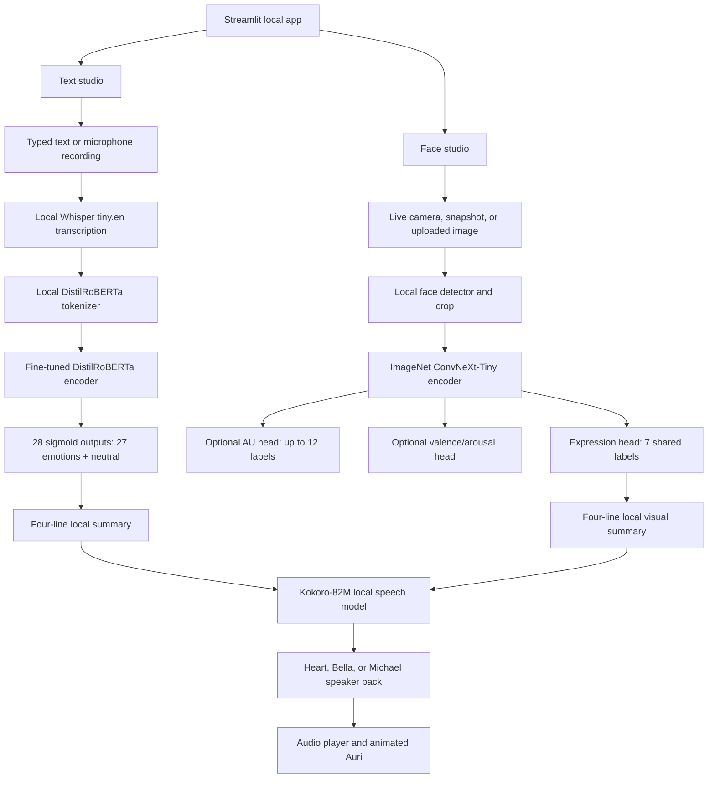

# Architecture

## App and modality design

The image and text encoders remain separate. No paired dataset here connects a face, its surrounding text, and an agreed emotion label, so fusing the scores would add an unsupported assumption. The app loads local checkpoints and sets Transformers and Hugging Face to offline mode. Dataset/base-weight downloads happen before training as ordinary files. Microphone audio is recorded in the browser until the user stops, then the downloaded Whisper tiny.en model transcribes it locally. The transcript is then analyzed by the local text model. Spoken summaries are composed directly from model scores and synthesized locally; neither speech direction uses a hosted API.

## Face branch

TorchVision ConvNeXt-Tiny starts from its ImageNet-1K weights, accepts a 224 x 224 face crop, and feeds a 512-dimensional shared representation. Separate heads predict the seven common expression labels, up to 12 action units (AUs), and valence/arousal. Missing targets are masked in the loss. Checkpoints record which outputs received labels, and the UI hides untrained outputs.

Expression and categorical emotion-from-face are the same supervised prediction in most of these datasets. AUs describe visible facial muscle actions and valence/arousal are continuous affect annotations; these are distinct tasks. The detector is a replaceable face-localization step. The current prototype uses OpenCV 4's bundled frontal Haar cascade and reports detection failure separately. The UI supports a WebRTC live camera preview, a camera snapshot, uploaded images, and a download of the most recent eight seconds of the annotated live stream. Live predictions refresh every few frames to keep the preview responsive.

### Face loss and data

- Expression: soft-target cross-entropy where votes are available; UIBAIFED uses one-hot labels.
- AUs: masked binary cross-entropy with logits.
- Valence/arousal: masked Smooth L1 in the starter implementation. A research run can add a CCC objective.
- Training handles absent labels per sample and measures expression accuracy/macro-F1, per-task AU F1, and valence/arousal CCC on validation/test manifests.

The seven expression classes are neutral, happiness, surprise, sadness, anger, disgust, and fear. This is the shared taxonomy across the starter FER+ data and Aff-Wild2. FER+ contempt, unknown, and non-face-heavy rows are discarded instead of being silently relabeled. Dataset-specific `other` labels should also be excluded unless the taxonomy is deliberately changed and the model retrained.

**Data stages:**

1. UIBAIFED (downloaded/open source) exercises the full image pipeline with synthetic faces. Its 2,948 images are not representative of webcam imagery; group demographic prompt variants before splitting and do not claim real-world generalization from this set.
2. FER+ is the natural-image starter. It contains 10 annotator votes per original FER2013 image. Microsoft distributes the annotations, not the FER2013 source photos; those must be obtained under the original source terms.
3. Aff-Wild2 is the preferred full research set after authorized academic access. It contains in-the-wild video with expression, valence/arousal, and AU annotations. Split at source video/person level, sample frames only after the split, and use its access conditions. It is not included because access is controlled.

## Text branch

DistilRoBERTa-base (82M parameters) is a pretrained English encoder fine-tuned on GoEmotions. A linear sequence-classification head emits 28 sigmoid scores, because one comment can carry several labels. The training loss is binary cross-entropy; per-label thresholds are selected on dev data, then metrics are reported once on the untouched test split. Dynamic padding, maximum token length 96, gradient accumulation, and CUDA mixed precision make GPU memory adjustable.

GoEmotions has 43,410 train, 5,426 dev, and 5,427 test examples in its official simplified release, with 27 emotions plus Neutral. It is English Reddit text; its annotators and source community do not represent all people or contexts. The app shows several labels with their scores rather than forcing a single categorical answer.

## Offline behavior

- `tools/download_assets.py` downloads fixed local data/model files during setup.
- `tools/download_tts_assets.py` downloads a pinned Kokoro-82M checkpoint and three speaker packs into `models/tts/kokoro/`.
- `tools/download_stt_assets.py` downloads a pinned English Whisper tiny.en checkpoint into `models/stt/whisper-tiny.en/`.
- `tools/train.py` loads the local ConvNeXt checkpoint and the manifest; `tools/train_text.py` loads the local tokenizer/base checkpoint with `local_files_only=True`.
- `app.py` sets `HF_HUB_OFFLINE=1` and `TRANSFORMERS_OFFLINE=1`, and loads the saved face/text checkpoints plus the local speech weights and voice packs.
- Face and text emotion inference use the saved local checkpoints without a hosted inference provider, account token, or model download.
- Speech summaries load the local Kokoro checkpoint, speaker packs, and locally installed English phoneme model; no network request is made during synthesis.
- Speech dictation records a local browser audio blob, then sends it only to the app's Python process for local Whisper inference; it does not invoke the browser's cloud SpeechRecognition service.
- Live camera analysis uses the local WebRTC stream and OpenCV detector.
- Microphone capture uses the browser's local `MediaRecorder` API; transcription runs against the downloaded Whisper model in the app process. No audio is sent to a hosted recognition service.

## Evaluation

Report held-out metrics by modality and task: text micro/macro/weighted F1; expression accuracy, macro-F1, balanced accuracy and confusion matrix; AU per-unit F1; valence/arousal CCC. Compare UIBAIFED synthetic results with a permitted natural-image set and document low-light, pose, occlusion, class imbalance, and demographic subgroup failures where labels allow. Do not tune thresholds or choose models on the held-out test set.

## Sources

- [GoEmotions official repository](https://github.com/google-research/google-research/tree/master/goemotions) and [paper](https://aclanthology.org/2020.acl-main.372/) — data, label format, fixed splits, limitations.
- [DistilRoBERTa-base model card](https://huggingface.co/distilbert/distilroberta-base) — 82M parameter encoder and Apache 2.0 model license.
- [Aff-Wild2 official ABAW/iBUG access page](https://ibug.doc.ic.ac.uk/resources/fg-2020-competition-affective-behavior-analysis/) and [multi-task paper](https://arxiv.org/abs/1910.04855).
- [Microsoft FER+ repository](https://github.com/microsoft/FERPlus) — annotation votes and original-image caveat.
- [UIBAIFED Zenodo record](https://zenodo.org/records/15181380) and [paper](https://ceur-ws.org/Vol-4000/paper15.pdf) — synthetic facial-expression dataset details.
- [AffectNet academic-use license](https://mohammadmahoor.com/wp-content/uploads/2024/06/AffectNet-Agreement-v2.1-10May2024.pdf).
- [TorchVision ConvNeXt models](https://docs.pytorch.org/vision/stable/models/convnext.html).
- [Kokoro-82M model card](https://huggingface.co/hexgrad/Kokoro-82M), [official Python loader](https://github.com/hexgrad/kokoro/blob/main/kokoro/model.py), and [voice loader](https://github.com/hexgrad/kokoro/blob/main/kokoro/pipeline.py) — open-weight local TTS and speaker packs.
- [Systran faster-whisper tiny.en model card](https://huggingface.co/Systran/faster-whisper-tiny.en) and [faster-whisper local model loader](https://github.com/SYSTRAN/faster-whisper/blob/master/faster_whisper/transcribe.py) — English speech recognition using a local CTranslate2 checkpoint.
- [Emotional Expressions Reconsidered](https://pmc.ncbi.nlm.nih.gov/articles/PMC6640856/) — limits of inferring internal feeling from facial movements.
